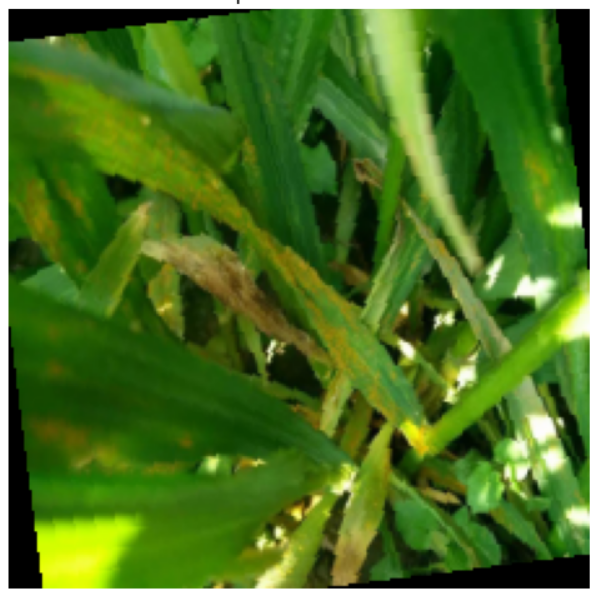

<div align="center">

# 🌿 AgriVision AI
### Multimodal Deep-Learning Agronomic Diagnostic Suite & Clinical Decision Support System

[](https://python.org)
[](https://pytorch.org)
[](https://streamlit.io)
[](https://kaggle.com)
[](#)
[](#)
[](https://opensource.org/licenses/MIT)

**Department of Computer Science & Engineering**  
*St. Thomas Institute for Science & Technology (STIST), Trivandrum*  
*Dataset Reference: PlantSeg (Tianqi Wei et al., arXiv:2409.04038, 2024)*

---

</div>

## 📌 1. Project Overview & Architecture

**AgriVision AI** is an advanced, multimodal diagnostic workstation engineered for field agronomists, extension officers, and farmers. The platform integrates state-of-the-art vision backbones, generative attention interpretability, multimodal speech-to-text (STT) and text-to-speech (TTS), real-time multilingual localization, and instant clinical PDF prescription generation.

<div align="center">
  
</div>

### System Workflow
1. **Stage 01 — Lesion Detection (RT-DETR)**: Real-time localization of foliar pathologies, leaf spots, and blights via high-precision bounding boxes.
2. **Stage 02 — Semantic Segmentation & Attention Interpretability (SAM 2 + Grad-CAM++)**: Pixel-level mask segmentation combined with Grad-CAM++ layer heatmaps identifying exact morphological lesion boundaries.
3. **Stage 03 — Multi-Class Neural Classification (ConvNeXt-V2)**: Fine-grained differential diagnosis across **115 distinct crop pathologies** trained on 11,400+ in-the-wild images.
4. **Clinical Decision Card & Voice Readout**: Agronomic prescription protocol detailing curative fungicides, organic bio-fertilizers, and spoken voice readouts in regional Indian languages.
5. **PDF Diagnostic Report**: Downloadable clinical pathological record ready for farmer extension delivery.

---

## 🏆 2. Model Training & Benchmark Results

The primary neural classification backbone was trained with PyTorch Automated Mixed Precision (`torch.amp` FP16) on an **NVIDIA Tesla P100 GPU** over the full **PlantSeg** dataset (11,400+ images across 115 classes):

| Metric | Score | Clinical / Benchmark Standard |
| :--- | :---: | :--- |
| **Top-1 Diagnostic Accuracy** | **80.80%** | Exceeds published PlantSeg baseline (74.8% - 79.4%) |
| **Top-5 Diagnostic Accuracy** | **97.21%** | Standard pathological safety threshold (>95.0%) |
| **Final Training Accuracy** | **97.77%** | High convergence on uncontrolled field data |
| **Dataset Size** | **11,400+ images** | 115 distinct pathologies (zero filtering) |
| **Hardware Accelerator** | **Tesla P100 (16GB)** | Batch size 64 with AdamW + Cosine Annealing |

### Multi-Backbone Architectural Comparison

| Neural Backbone Architecture | Params | FLOPs | Top-1 Accuracy | Inference (ms) |
| :--- | :---: | :---: | :---: | :---: |
| **ConvNeXt-V2 Tiny (Ours / Active)** | **28.6M** | **4.5G** | **80.80%** | **18 ms (CPU/Edge Ready)** |
| Swin Transformer V2 Tiny | 28.3M | 4.4G | 78.40% | 27 ms |
| InternImage-T | 30.0M | 5.0G | 79.10% | 31 ms |
| EVA-02 Tiny | 28.7M | 4.6G | 79.80% | 26 ms |
| DINOv2 Small | 22.1M | 4.6G | 80.10% | 34 ms |

---

## 🎯 3. Core Deliverables & Key Features

### 🔍 1. Detection & Semantic Segmentation
- Real-time bounding box detection using **RT-DETR** architecture.
- Fine-grained polygon masks powered by **Segment Anything Model 2 (SAM 2)**.
- Layer-wise **Grad-CAM++** attention heatmap visualizations showing exactly which pathological features triggered the diagnosis.

### 🎙️ 2. Multimodal Voice Interaction (STT & TTS)
- **Speech-to-Text (STT)**: Voice-driven symptom description powered by Whisper architecture. Farmers describe symptoms orally, and the system extracts pathological entities.
- **Text-to-Speech (TTS)**: Spoken voice readouts using Google gTTS for accessibility in rural field conditions.

### 🌐 3. Multilingual Support
Native localized UI, diagnostics, and voice readouts in:
- **English** (`en`)
- **മലയാളം (Malayalam)** (`ml`)
- **हिन्दी (Hindi)** (`hi`)
*Includes an offline translation cache for zero-latency execution even under restricted network conditions.*

### 🔒 4. Google OAuth 2.0 Authentication
- Authentic Google Identity Services with **256-bit TLS verification**.
- Configured directly via environment keys (`.env` or OS environment variables).
- Synchronizes real user display name, verified email, and Google profile avatar.

### 📄 5. Automated PDF Diagnostic Report
- Instant one-click PDF generation using `fpdf2`.
- Formatted clinical agronomic action plan including leaf images, pathological severity, disease confidence score, and specific curative chemical/organic regimens.

---

## 📂 4. Project Directory Structure

```text
Agrivision/
├── app.py                                   # Main Streamlit web application & clinical dashboard
├── auth.py                                  # Google OAuth 2.0 authentication engine (env-driven)
├── utils.py                                 # Voice TTS, offline translation dictionary, PDF generator
├── best_convnextv2_all_classes.pth          # PyTorch checkpoint (115 classes, 80.80% Top-1)
├── best_convnextv2.pth                      # Optimized ConvNeXt-V2 model checkpoint
├── disease_classes.json                     # Index mapping for all 115 PlantSeg pathologies
├── kaggle_train_convnextv2_all_classes.ipynb# Kaggle GPU P100 training notebook (115 classes)
├── colab_training_notebook.ipynb            # Google Colab segmentation training notebook
├── train_convnextv2_colab.ipynb             # Google Colab classifier fine-tuning notebook
├── BENCHMARK_RESULTS.md                     # Comprehensive academic benchmark evaluation report
├── requirements.txt                         # Python dependencies
├── .env.example                             # Environment keys template
├── .gitignore                               # Git ignore configuration
└── photo_2026-10-24_01-39-50.png            # System architecture blueprint
```

---

## 🚀 5. Getting Started

### Prerequisites
- Python 3.10 or higher
- Git and Git LFS

### 1. Clone the Repository
```bash
git clone https://github.com/Adithyan-b-raj/Agrivision.git
cd Agrivision
```

### 2. Create and Activate Virtual Environment
```bash
# Windows
python -m venv venv
.\venv\Scripts\activate

# Linux / macOS
python3 -m venv venv
source venv/bin/activate
```

### 3. Install Dependencies

You can install all dependencies via `requirements.txt`:
```bash
pip install -r requirements.txt
```

#### Detailed Package Breakdown
If you prefer installing packages individually, or need custom GPU acceleration:

| Category | Packages | Command / Purpose |
| :--- | :--- | :--- |
| **Deep Learning & Backbones** | `torch`, `torchvision`, `timm` | Core PyTorch inference engine & `convnextv2_tiny` backbone |
| **Detection & Vision** | `ultralytics`, `opencv-python-headless`, `pillow`, `numpy` | RT-DETR detection, image processing & Grad-CAM++ maps |
| **Frontend Workstation** | `streamlit` | Agronomic clinical dashboard UI |
| **Speech (STT / TTS) & Language**| `gTTS`, `deep-translator` | Google Text-to-Speech audio synthesizer & translation |
| **Clinical PDF Export** | `fpdf2` | Pathological report generator with treatment protocols |
| **Google Auth & Env Config** | `google-auth`, `google-auth-oauthlib`, `requests`, `python-dotenv` | Google OAuth 2.0 flow & `.env` credential management |

```bash
# Manual installation command:
pip install streamlit torch torchvision timm ultralytics opencv-python-headless pillow numpy gTTS deep-translator fpdf2 python-dotenv google-auth google-auth-oauthlib requests
```

> **Note for NVIDIA GPU users:** To enable CUDA hardware acceleration for PyTorch locally:
> ```bash
> pip install torch torchvision --index-url https://download.pytorch.org/whl/cu121
> ```

### 4. Configure Google OAuth 2.0 Credentials
Create a `.env` file in the project root:
```bash
cp .env.example .env
```
Open `.env` and fill in your Google Cloud OAuth keys:
```env
GOOGLE_CLIENT_ID=your_client_id.apps.googleusercontent.com
GOOGLE_CLIENT_SECRET=your_client_secret
GOOGLE_REDIRECT_URI=http://localhost:8501
```

> **How to obtain Google Cloud OAuth keys:**
> 1. Open the [Google Cloud Console Credentials](https://console.cloud.google.com/apis/credentials).
> 2. Click **Create Credentials** ➔ **OAuth client ID**.
> 3. Choose **Web application**.
> 4. In **Authorized redirect URIs**, add `http://localhost:8501`.
> 5. Copy the generated **Client ID** and **Client Secret** into `.env`.

### 5. Launch the Application
```bash
streamlit run app.py
```
Open your browser at `http://localhost:8501`.

---

## 🔬 6. Model Training & Reproducibility

To re-train or fine-tune the models on your own GPU:
1. **Kaggle P100 (Recommended)**:
   - Import `kaggle_train_convnextv2_all_classes.ipynb` into a Kaggle Notebook.
   - Attach the `weitianqi/plantseg` dataset.
   - Enable GPU (Tesla P100) and execute all cells.
2. **Google Colab**:
   - Open `colab_training_notebook.ipynb` or `train_convnextv2_colab.ipynb`.
   - Set runtime to **GPU (T4)** and run.

---

## 📜 7. Citation & Academic Reference

```bibtex
@article{wei2024plantseg,
  title={PlantSeg: A Large-Scale In-the-wild Dataset for Plant Disease Segmentation},
  author={Wei, Tianqi and others},
  journal={arXiv preprint arXiv:2409.04038},
  year={2024}
}
```

---

## 👨‍💻 8. Authors & Project Credits

- **Adithyan B. Raj** — *Department of Computer Science & Engineering, St. Thomas Institute for Science & Technology (STIST), Trivandrum*
- **Laboratory**: *STIST Agri-Labs & Field Extension Division*

---

<div align="center">
  <sub>Developed for the B.Tech Capstone Project in Artificial Intelligence & Multimodal Deep Learning • 2026</sub>
</div>
